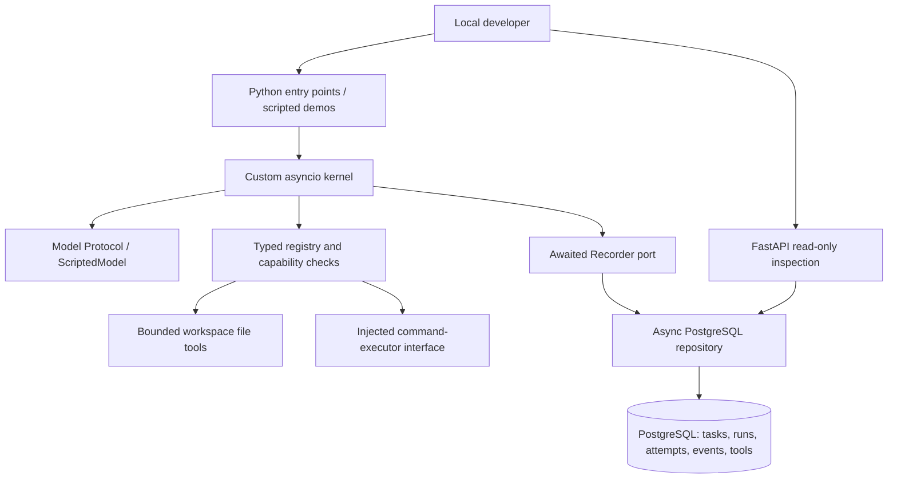

# Kairo architecture — implemented through M3

Authority: `prd.md`, with explicit user updates for solo development and combined
M0–M3 study. Exact paths are relative to `/Users/somyadeeptarat/Desktop/Kairo`.
Design history is retained in `docs/decisions/`; all study material is in
`docs/learning/guide.md` without separate learning gates.

## Current system

The model proposes actions. The custom runtime owns lifecycle, limits and context.
The registry validates schemas and permissions before invoking typed handlers.
An optional awaited recorder persists progress in PostgreSQL. A read-only API
inspects that storage independently of the executing process.

There is no default host command executor. The command interface fails explicitly
when none is supplied. There is no Docker execution sandbox, live Ollama adapter,
scheduler, worker service, checkpoint recovery, approval flow or dashboard yet.
The PostgreSQL container is infrastructure, not an agent sandbox.

## Boundaries and contracts

| Boundary | Implemented owner / contract | Failure behavior |
| --- | --- | --- |
| Lifecycle | `packages/core/src/kairo_core/state.py`: explicit validated transitions | Reject illegal edges; terminal runs immutable |
| Execution | `packages/core/src/kairo_core/runtime.py`: `run_agent` creates fresh IDs and bounded sequential calls | Terminal outcome or propagated storage/caller cancellation error; no retries |
| Intelligence | `packages/core/src/kairo_core/models.py`: async Model Protocol, structured outputs | Invalid outputs/model errors become explicit failures |
| Tools | `packages/core/src/kairo_core/tools/registry.py`: strict schemas, capability checks and typed outcomes | Rejections never invoke handler; uncertain mutations stop the run |
| Files | `packages/core/src/kairo_core/tools/files.py`: descriptor-relative regular-file operations | Traversal/symlink/hardlink/size protections; not hostile-process isolation |
| Recording | `packages/core/src/kairo_core/events.py`: start and awaited record | Commit or raise; no background record loss |
| Persistence | `packages/core/src/kairo_core/persistence/repository.py`: transactions and per-run row locks | Snapshot/event commit together or roll back; incomplete work remains visible |
| Presentation boundary | `apps/api/src/kairo_api/main.py`: paginated read-only HTTP views | 404 unknown, 422 invalid input, 503 storage unavailable |

The runtime imports the recording contract rather than SQLAlchemy. The database
adapter implements that contract. HTTP handlers inspect records and do not run
model-generated actions. Domain correctness must remain independent of HTTP.

## State and durability

A task represents requested work. A run owns its lifecycle. An attempt identifies
one execution incarnation. M3 creates one task and attempt with each run; scheduling
multiple attempts or resuming interrupted work is not implemented. New run_agent
calls get fresh IDs. UTC timestamps are for inspection; per-run sequence numbers
provide durable order.

Start commits identities and CREATED together. Each lifecycle update checks the
expected source and current attempt under a run-row lock. Status, attempt state,
output/error and transition event commit atomically. Model requests and tool dispatch
are committed before those operations; outcomes follow afterward. Database errors
stop execution. The filesystem and PostgreSQL cannot share an atomic transaction,
so a dispatched mutating action remains uncertain until its completion is recorded.

The inspection API survives execution-process restarts because it reads committed
rows. Interrupted runs retain last known states; M3 does not invent a terminal
outcome, reclaim work or repeat side effects. Redaction handles known structured
keys/common credential patterns, not all secrets; use dedicated trusted workspaces.

## Local deployment and dependencies

Python/API run on the macOS ARM64 host. Docker Compose runs PostgreSQL on loopback
port 55432 with a named volume. API binds to loopback; no authentication/public
hosting is implemented. Ollama and Next.js remain future local integrations.

Pydantic validates tool/HTTP data. SQLAlchemy asyncio and psycopg manage database
I/O; Alembic versions its structure. FastAPI/uvicorn expose inspection; HTTPX tests
it. No agent framework owns orchestration, and no Redis, paid API or cloud service
is introduced. Dependency choices are recorded in ADRs 0003, 0006 and 0007.
