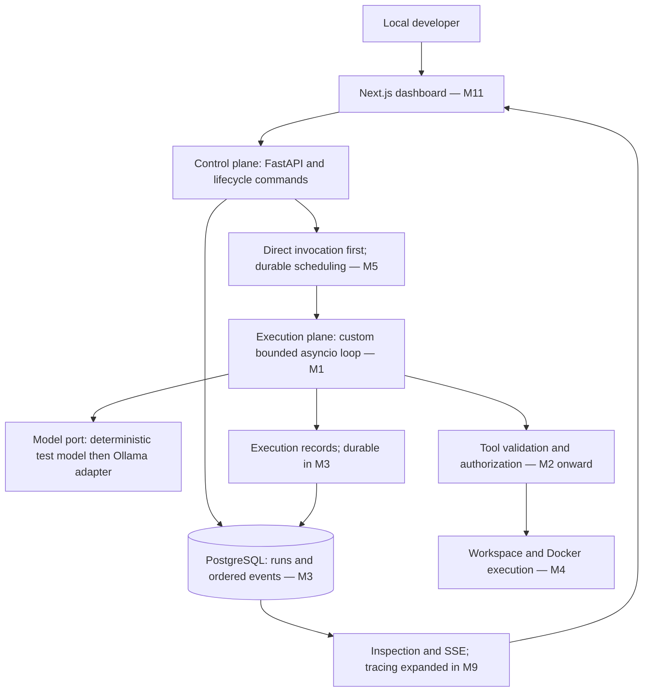

# Kairo architecture — M1 baseline

Authority: `prd.md`, especially §§6–8, 11, 13–18, with the explicit solo-development
update in `docs/decisions/0004-solo-development.md`. Everything below describes the
intended system unless explicitly identified as implemented. M1 implements the
in-memory kernel, lifecycle policy, configuration and scripted model contract;
M0 supplied engineering utilities and documentation. Paths in this document are relative to
`/Users/somyadeeptarat/Desktop/Kairo`.

## What we are building

An LLM predicts a response; it does not provide reliable scheduling, authorization,
transactions, or recovery. Kairo supplies that infrastructure. A custom loop will
assemble context, request a response, validate a proposed action, invoke a permitted
tool, record the result, and repeat within explicit limits. Model output is input to
our program, never authorization or arbitrary Python to execute.

Start with a modular Python application in one process. A module is a code boundary;
a process is an operating-system execution boundary. We need the first immediately,
not the second. Extract workers only when scheduling requires them. Next.js is a
presentation client, not the owner of execution truth.

This diagram is a roadmap, not a claim that all services exist. Implemented in M1:
`packages/core/src/kairo_core/state.py`, `packages/core/src/kairo_core/models.py`,
and `packages/core/src/kairo_core/runtime.py`. Only the scripted model adapter is
available; it performs no inference. There is no API, database, tool execution or
web application yet. Concrete M1 contracts and evidence are in
`docs/milestones/M1.md`; design tradeoffs are in
`docs/decisions/0005-single-agent-kernel.md`.

## Ownership and boundaries

| Boundary | Owns | Must not do |
| --- | --- | --- |
| Control plane | Validate task/configuration, accept lifecycle commands, later schedule/claim work | Execute model-generated commands in HTTP handlers |
| Execution plane | Bounded loop, tool dispatch, workspace lifecycle, cancellation cleanup | Bypass backend authorization or mutate dashboard state |
| Intelligence | Model transport, structured responses, working context | Decide permissions or own durable task status |
| Persistence | Transactions, records, ordered durable history | Encode model reasoning or treat logs as committed state |
| Observability | Logs, timing, correlations, inspection views | Invent metrics or become a second lifecycle authority |
| Presentation | Render server data and submit commands | Authorize tools or fabricate execution progress |

One lifecycle service will validate all mutations. A worker requests a transition;
it does not invent its own lifecycle rules. At M3, state update and its event must
commit in one transaction. A failed commit must not appear successful to a caller.
There is no transaction spanning PostgreSQL and an external command: uncertain
side effects require explicit reconciliation, not an exactly-once claim.

## Dependency direction and deployment

Domain/runtime code depends on small contracts, not FastAPI, SQLAlchemy, or Ollama
transport details. Adapters implement contracts; the application composition layer
connects them. This is dependency inversion: the caller describes what it needs,
so tests can supply a deterministic implementation without an HTTP server or model.
Do not create an abstract interface for every function; introduce a port when a real
external dependency needs replacing in tests or another implementation exists.

Python and later Next.js run on the macOS host. Ollama runs natively for local
hardware acceleration. PostgreSQL later runs in a local container; execution
containers arrive separately in M4. A database container is not an agent sandbox.
Bind future local APIs/database ports to loopback. Execution containers must not
inherit host secrets, Docker socket, or unrestricted filesystem mounts.

## Contracts to agree before module implementation

These are system-level obligations, not frozen wire schemas. M1 implements only
the kernel subset described in `docs/milestones/M1.md`.
Exact endpoint payloads belong to their implementation milestone (PRD §10).

| Interface | Input | Output / failure | Owner |
| --- | --- | --- | --- |
| Lifecycle | Run identity, expected current state, requested target, cause | Accepted transition or explicit invalid/stale-state error | Lifecycle policy; persistence adapter |
| Runtime | Task text, run/attempt identity, model port, limits, cancellation signal | Terminal outcome and ordered step records; bounded timeout/cancellation | Runtime/intelligence |
| Model port | Explicit messages, available tool schemas, request deadline | Structured final answer or tool requests; typed transport/validation/timeout errors | Runtime/intelligence |
| Tool executor | Invocation identity, validated name/arguments, policy and workspace context | Structured result/error, side-effect class, uncertain outcome when applicable | Tool schema; sandbox adapter |
| Event storage | Run/attempt identity, type, redacted payload, timestamp | Durable per-run sequence; transaction failure surfaced | Persistence |
| Cancellation | Run identity and cancellation request | Request accepted separately from eventual CANCELLED outcome | Control plane; execution plane |

Shared conventions: opaque UUID identities, UTC timezone-aware wall timestamps,
monotonic clocks for elapsed durations, JSON-compatible boundary payloads, bounded
outputs, and explicit errors. Model-supplied tool names and arguments are untrusted.
Per-run event order comes from sequence numbers, not clock timestamps. Future
approvals bind to exact action inputs and identity, never an entire session.

A task is requested work. A run is its lifecycle. A run attempt is one execution
incarnation. Terminal runs never resume: a retry creates a new run linked to the
same task; recovery can create a new attempt only for a nonterminal run under an
explicit recovery protocol. M6 will define that protocol and lease/fencing details.
A lost worker is not proof that a tool did nothing.

## Why this stays small

Microservices introduce deployment and network failures before we have a useful
kernel. A framework-owned agent loop hides the very logic we want to learn. A
custom bounded asyncio loop preserves inspectability; asyncio overlaps I/O, not
CPU-heavy Python work. PostgreSQL later supplies both state and the initial queue,
avoiding a second consistency boundary with Redis. A state snapshot plus ordered
history is sufficient; a full event-sourcing framework is not required.
