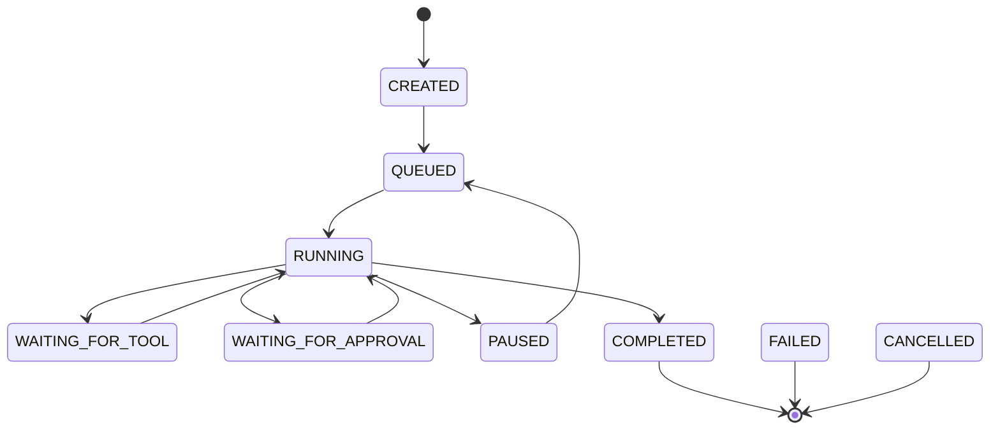

# Initial run state machine specification

The shared policy lives in `packages/core/src/kairo_core/state.py`; all state
pairs are tested. The runtime uses CREATED, QUEUED, RUNNING, WAITING_FOR_TOOL,
COMPLETED, FAILED and CANCELLED. Approval and pause/resume remain specifications,
not implemented capabilities. M3 persists actual transitions and their events in
one PostgreSQL transaction. Scheduling/recovery belong to M5/M6.

| Source | Allowed targets | Cause / constraint |
| --- | --- | --- |
| CREATED | QUEUED, CANCELLED, FAILED | Validated enqueue; cancellation; setup failure |
| QUEUED | RUNNING, CANCELLED, FAILED | Single owner starts; cancellation; unrecoverable dispatch failure |
| RUNNING | WAITING_FOR_TOOL, WAITING_FOR_APPROVAL, PAUSED, COMPLETED, FAILED, CANCELLED | Validated next action; safe pause; final answer; fatal failure; acknowledged cancellation |
| WAITING_FOR_TOOL | RUNNING, FAILED, CANCELLED | Result or recoverable tool error returns to loop; fatal error; cancellation after cleanup |
| WAITING_FOR_APPROVAL | RUNNING, FAILED, CANCELLED | Exact action approved, or denial returned to loop without executing; fatal policy failure; cancellation |
| PAUSED | QUEUED, FAILED, CANCELLED | Explicit safe resume through dispatch; unrecoverable paused state; cancellation |
| COMPLETED | none | Successful final result |
| FAILED | none | Terminal failure |
| CANCELLED | none | Cancellation completed |

All unlisted transitions, including self-transitions, are illegal. CREATED does not
jump directly to RUNNING: the initial in-process dispatcher can pass through QUEUED
without implementing a durable queue. Only M1's executable subset is enabled there;
WAITING_FOR_TOOL, WAITING_FOR_APPROVAL and PAUSED must not imply implemented features.

The table is authoritative. For readability the diagram omits FAILED/CANCELLED
edges from every nonterminal state.

## Invariants and failure semantics

- Only RUNNING can complete. Terminal state means no more model or tool calls.
- A cancellation request is intent, not immediate proof of stopped work. CANCELLED
  is recorded after active work is stopped or its uncertain outcome is recorded.
- Overall deadline exhaustion and step-budget exhaustion produce FAILED with a
  distinct reason. A recoverable tool failure can return to RUNNING within budget.
- Approval denial never invokes the denied action. Returning a denial to the loop
  allows another permitted strategy; any fatal denial must have an explicit cause.
- Pause is cooperative at a safe step boundary, never arbitrary process suspension.
  If work is in flight, finish or reconcile it before acknowledging a pause.
- Worker disappearance does not automatically mark FAILED or resume RUNNING.
  M3 retains committed history, but automatic execution recovery remains unimplemented.
- Persisted transitions check expected source/current attempt under a per-run
  row lock. State and its durable event form one atomic database operation.
- No terminal-to-nonterminal transition; new retries get new run identities.

## Validation and future boundaries

M1: parameterize every source/target pair, reject every illegal edge, cover terminal
immutability, step/deadline limits, and cancellation using deterministic models.
Test disabled capabilities as well as the shared graph. No inference required.
M3: transaction rollback and restart durability. M5: competing claims and stale
owners. M6: crash before/after side effect and lost acknowledgment. A graph alone
cannot prove any of those runtime guarantees.

M2 update: WAITING_FOR_TOOL is now used by the runtime. Tool outcomes return to
RUNNING unless cancelled, timed out by the runtime or uncertain. Unknown/invalid/
denied calls are recorded without executing the denied handler. Approval and pause
states remain future capabilities.

M3 tests now cover transactional rollback, schema migration roundtrips, repository/API
recreation, concurrent event sequencing and retained history after process termination.
These do not establish M5 task-claim exclusivity or M6 safe recovery. Details and
commands are in `docs/milestones/M3.md` and `docs/learning/guide.md`.
